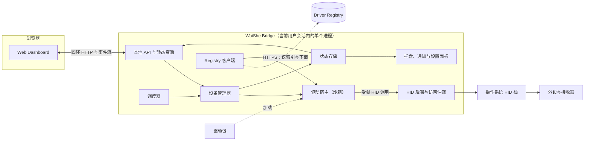
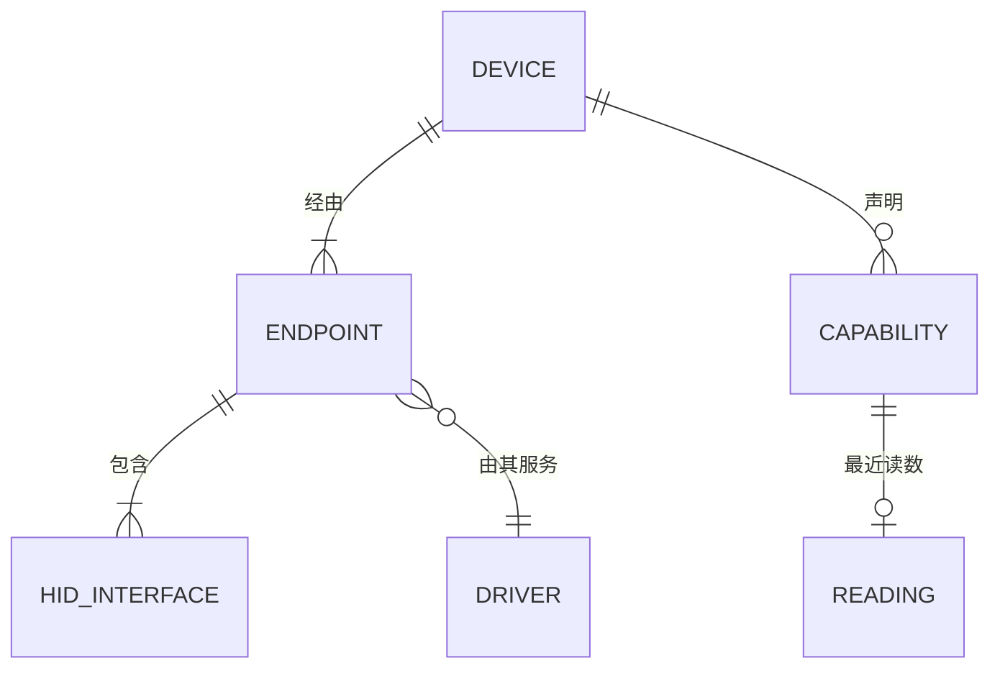
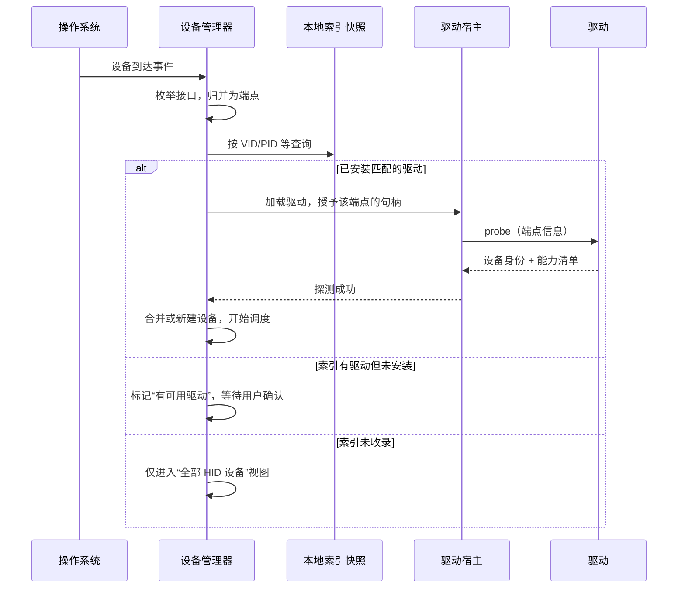
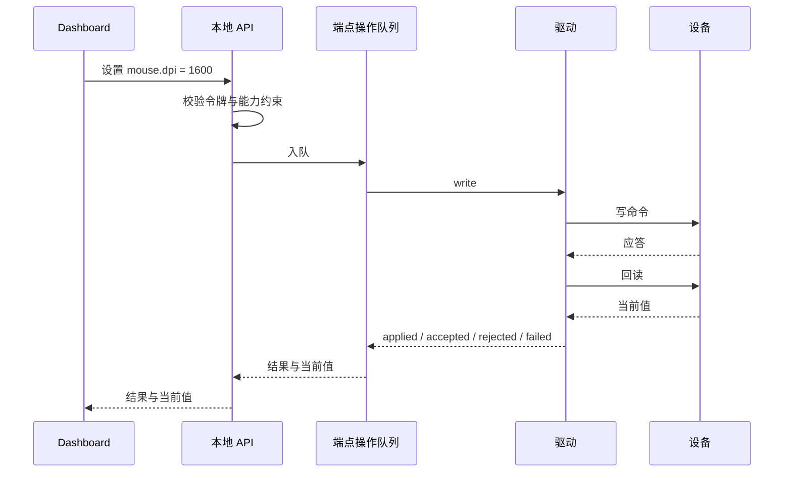
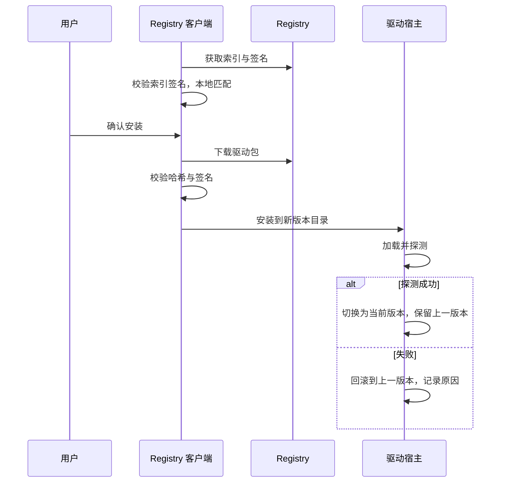
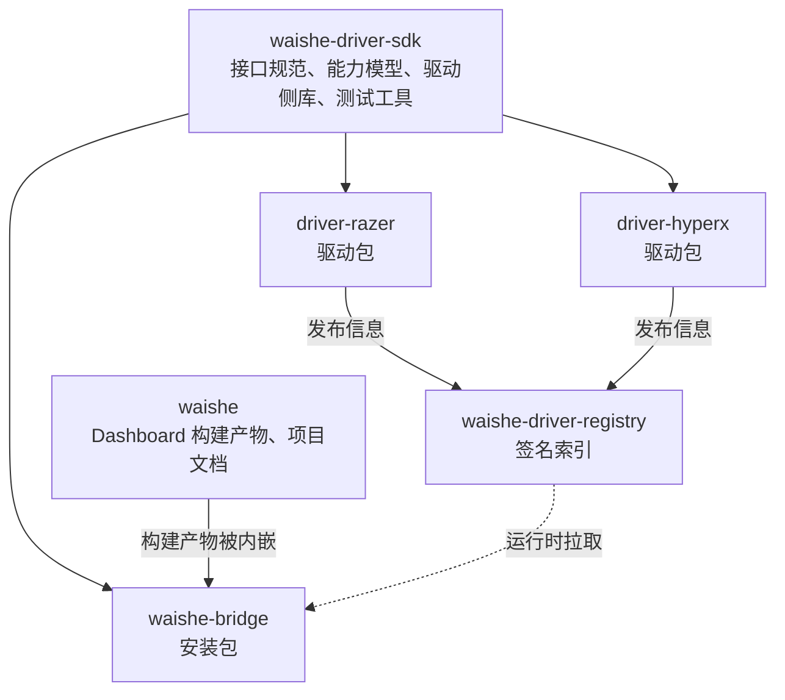

# WaiShe 架构概览

| 项 | 内容 |
| --- | --- |
| 状态 | 草案。插件运行时（[ADR-0003](decisions/0003-driver-plugin-runtime.md)）与本地 API 鉴权（[ADR-0004](decisions/0004-dashboard-hosting-and-local-api-auth.md)）已经 M0 验证并接受 |
| 日期 | 2026-11-14 |
| 对应需求 | [requirements.md](requirements.md) |

本文描述组件边界、数据模型和关键流程。接口细节在各自仓库：

- 驱动接口与能力模型：`waishe-driver-sdk` 仓库 `docs/driver-interface.md`、`docs/capabilities.md`
- 本地 API：`waishe-bridge` 仓库 `docs/local-api.md`
- 索引与驱动包格式：`waishe-driver-registry` 仓库 `docs/registry-format.md`

## 1. 组件与边界

三条硬边界：

1. **网页不接触 HID。** Dashboard 只调用能力级 API（“把 `mouse.dpi` 设为 1600”），拿不到原始报文通道（SEC-04）。
2. **驱动不接触系统。** 驱动只能对 Bridge 交给它的设备句柄收发报文，没有文件、网络、进程访问，也不能自行枚举设备（DRV-06）。
3. **Registry 不接触用户。** 它是静态索引加驱动包下载，Bridge 把索引拉到本地比对，不上报设备清单（PRIV-04）。

## 2. 进程模型

- Bridge 是登录用户会话内的普通进程，不是 Windows 服务。托盘和通知需要用户会话；不提权也就不需要管理员安装（APP-01）。OpenMouse Bridge 采用同样的形态。
- 驱动是 WebAssembly 核心模块，在 Bridge 进程内由 wasmi 运行（ADR-0003）。每个驱动实例一个独立存储，有燃料与内存上限；阻塞型宿主调用由宿主设超时。
- Dashboard 是静态资源，由 Bridge 在回环地址上同源提供（ADR-0004）。
- 无设备在线时：不加载驱动，没有周期性硬件访问，只保留热插拔监听和托盘（PERF-02）。

## 3. 数据模型

| 实体 | 关键字段 | 说明 |
| --- | --- | --- |
| Device | 稳定 ID、品牌、型号、类型、别名 | 展示单位 |
| Endpoint | 连接方式、VID/PID、链路状态 | 一条连接路径 |
| HidInterface | 接口号、用途页/用途、报告长度、系统路径 | 实际打开的对象 |
| Capability | 能力 ID、访问方式（读/写/通知）、约束、持久性、验证等级 | 约束随当前端点变化 |
| Reading | 状态（`ok`/`unsupported`/`unavailable`/`unknown`）、值、读取时间、是否历史值 | 见需求 4.1 |

### 3.1 设备身份与去重

去重分两层：

1. **接口 → 端点**：由 Bridge 完成，不需要驱动。同一 USB 设备的多个 HID 接口和顶层集合归为一个端点。Windows 上的候选依据是设备的容器 ID 与实例路径前缀，M0 验证。
2. **端点 → 设备**：需要驱动参与。驱动在探测时返回设备的稳定标识（通常是序列号）。两个端点报告相同的标识时合并为一个设备，例如接收器在线的同时插线充电。驱动无法提供稳定标识时不合并，各端点作为独立设备展示。

接收器本身不是设备。驱动通过协议查询接收器后面的设备是否在线，结果体现为 `link.state` 能力（DISC-07）。

设备稳定 ID 由 Bridge 在本地生成并保存，不直接使用序列号，序列号不出本机（PRIV-03）。

## 4. 关键流程

### 4.1 发现与匹配

驱动匹配规则只是候选条件，最终以 `probe` 成功为准。同一 VID/PID 对应不同协议的情况很常见，例如共用接收器 PID 的不同型号。

### 4.2 读取：轮询与主动上报

两种来源汇入同一个状态存储：

- **轮询**：调度器按能力声明的建议间隔发起读取。默认 5 分钟（暂定）；有观察者（Dashboard 打开、托盘面板展开）时加快；设备休眠或连续失败时退避（TRAY-06）。
- **主动上报**：驱动声明需要监听的接口后，Bridge 持续读取该接口的输入报告并交给驱动解析为事件，例如耳机静音键（HEAD-04）。有主动上报的能力不轮询。

状态存储在值变化时通知托盘和已连接的 Dashboard。时效由 Bridge 统一判定，驱动不参与：读取时间超过阈值或端点断开即标记为历史值。

### 4.3 写入

- 每个端点一个操作队列，轮询、事件处理、用户写入全部经过它，保证报文不交错（CFG-03）。
- 约束校验做两次：Bridge 依据能力声明先拒绝非法值，驱动再按协议校验。
- 写入触发设备重新枚举时，队列保留该操作，等待端点重新出现后回读；超时才判为 `failed`（MOUSE-06）。

### 4.4 驱动安装与更新

已安装版本与候选版本并存，切换是一次原子的指针更新（REL-04、DRV-12）。

## 5. HID 访问层

Bridge 内部用一个后端抽象隔离平台差异，驱动和上层只看到统一的句柄操作：发送/获取特性报告、写输出报告、读输入报告。

Windows 首发的要点，均需 M0 验证：

| 事项 | 假设 |
| --- | --- |
| 系统输入集合 | 已验证（S1）：Razer 的控制报文位于系统独占的鼠标集合上，读写打开被拒绝，**以访问权限 0 打开**后特性报告收发正常。WaiShe 不读取、不独占系统输入集合的输入报告（REL-05） |
| 访问权限 | 已验证（S1）：两款首批设备的控制接口在无管理员权限、无厂商软件时均可访问。中等完整性级别的标准用户未单独测试 |
| 热插拔 | 使用系统设备通知，不靠定时全量扫描（DISC-02） |
| 睡眠唤醒 | 唤醒后句柄可能失效，需要重新枚举和重新打开（DISC-03） |
| 接口归并 | 已验证（S6）：同一接收器的全部 HID 节点共享同一个容器 ID，作为接口 → 端点的归并依据 |
| 输入报告广播 | 已验证：输入报告会送达打开同一接口的所有句柄，包括厂商软件。驱动必须按请求匹配应答，并容忍无关报告 |
| 厂商软件共存 | 部分验证（S2）：Synapse、NGENUITY 运行时读写均正常，10 秒内未观察到覆盖。Bridge 无法阻止对方发命令，只能检测并提示（CFG-04） |

## 6. 版本与兼容

三个接口独立版本化（MAINT-01）：

| 接口 | 规范所在 | 提供方 | 使用方 | 不兼容时 |
| --- | --- | --- | --- | --- |
| 驱动接口 | `waishe-driver-sdk` | Bridge | 驱动 | Bridge 拒绝加载并说明原因（DRV-07） |
| 本地 API | `waishe-bridge` | Bridge | Dashboard | Dashboard 提示版本不匹配（WEB-04） |
| Registry 索引格式 | `waishe-driver-registry` | Registry | Bridge | Bridge 忽略不认识的字段；主版本不同则提示升级 Bridge |

Bridge 内嵌一个固定版本的 Dashboard 构建产物，因此同源提供的 Dashboard 与 Bridge 始终匹配。版本不匹配只会出现在将来的托管版 Dashboard 上。

## 7. 仓库与构件

依赖只有一个方向：驱动和 Bridge 都依赖 SDK，彼此不依赖。Bridge 的安装包不包含任何驱动。

## 8. 与 OpenMouse 的架构差异

WaiShe 在产品形态上参考 OpenMouse，但协议代码的位置不同，这是有意的选择。

| | OpenMouse | WaiShe |
| --- | --- | --- |
| 协议实现位置 | 浏览器内的 TypeScript 驱动（`@openmouse/protocol`）；Bridge 另有少量原生电量读取器 | 只在 Bridge 加载的驱动里 |
| Bridge 对网页暴露 | 原始 HID 通道（WebSocket），供浏览器内驱动使用 | 能力级 API |
| 关闭网页后 | 仅有原生读取器的设备可继续读电量 | 全部已安装驱动照常工作 |
| 新增设备 | 更新协议包并重新部署网页 | 安装或更新一个驱动包 |

选择这一结构的原因：G2 要求不开网页也能监控所有设备；协议知识只存在一处；网页不持有硬件通道使鉴权面更小。代价是不能直接运行 OpenMouse 现有的 TypeScript 驱动，需要移植或重写，见 [ADR-0003](decisions/0003-driver-plugin-runtime.md)。

以上对 OpenMouse 的描述来自其 README（2026-11-14 读取）。

## 9. 跨平台策略

首发只做 Windows。为后续平台保留的约束：

- 平台相关代码限制在 HID 后端、托盘通知、自启、安装包四处。
- 驱动与平台无关：同一个驱动包在所有平台可用（这是 ADR-0003 倾向 WASM 的主要理由之一）。
- 本地 API 与 Dashboard 与平台无关。

Linux 需要额外处理 hidraw 权限规则，macOS 需要处理输入监控授权，均不在首期范围内。
